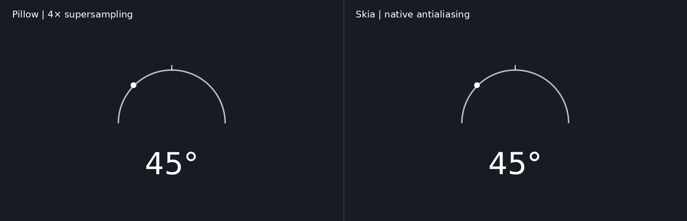

# Pillow / Skia prototype benchmark

These measurements were captured during the uncommitted prototype review.
The project now defaults to Skia AA=1; benchmark commands selected each backend
and AA explicitly. Source baseline: `95d216f3c063d359edf968b7449296ef2cd2b3de`.

## Method

24 full-HD (1920×1080) frames, three fresh output folders per configuration,
median end-to-end wall time. Runs include interpreter/worker startup, CSV and
manifest handling, drawing, downsampling where requested, PNG encoding and file
writes. Repeated-angle image reuse is not implemented in either backend.
Normal write completion is measured, without an explicit filesystem sync.
The sine-wave input contains 24 frame readings spanning -90° to +90°.
Configuration order alternates between repetitions.

Environment: Linux x86_64 cloud host, nine detected logical CPUs, Python 3.12.14,
Pillow 12.3.0, skia-python 144.1. Both backends use the same DejaVu Sans font
file because macOS Arial is unavailable here. This is a short shared-host
benchmark, not a controlled hardware comparison. Background validation work
also overlapped part of the initial repetitions; treat these as approximate
numbers, and rerun on the target Mac before relying on projected render times.
Multiprocessing uses this host's default start method in the timing runs;
macOS spawn startup is covered separately by correctness tests, not timings.

## Results

| Renderer | Workers | Median seconds / 24 frames | Frames/sec | Speedup vs Pillow with same workers |
| --- | ---: | ---: | ---: | ---: |
| Pillow, AA=4 / LANCZOS | 1 | 17.952 | 1.34 | 1.00× |
| Skia, AA=1 / native antialiasing | 1 | 1.883 | 12.75 | 9.53× |
| Skia, AA=4 / Mitchell cubic | 1 | 3.641 | 6.59 | 4.93× |
| Pillow, AA=4 / LANCZOS | 4 | 6.132 | 3.91 | 1.00× |
| Skia, AA=1 / native antialiasing | 4 | 0.778 | 30.85 | 7.88× |
| Skia, AA=4 / Mitchell cubic | 4 | 1.289 | 18.62 | 4.76× |

These are complete pipeline comparisons, including different PNG encoders and
antialiasing/resampling methods. Equal AA numbers do not mean equal filtering
or pixel-equivalent quality. The native Skia advantage includes avoiding
full-frame supersampling. No isolated drawing-only or PNG-encoding-only
speedup is claimed. The Skia PNG quality argument is not a lossiness setting;
PNG output is lossless. GPU acceleration is not used.

[Raw timings and environment](results.json) · [CSV input](benchmark.csv)

## Appearance

Both sample frames represent -45° and display 45°. Both original files are
1920×1080 RGBA PNGs with transparent backgrounds. The side-by-side preview is
composited on a dark background **only for inspection** and displays each
image at half size. The actual renderer does not add a background or titles.



Original frames: [Pillow AA=4](pillow-45.png), [Skia native AA=1](skia-45.png),
[Skia AA=4](skia-aa4-45.png).

The minimalist design, arc placement, dot motion, number, and zero tick are
preserved. These are not pixel-identical outputs. Text hinting, fractional
positioning, edge coverage and blending can differ between libraries. Native
Skia and Pillow 4× also differ in how font size and stroke widths are rounded.
The preview looked close at normal viewing size; the user approved switching to Skia after reviewing this comparison.
macOS Arial output must still be checked on macOS.

## Verification

Eight integration tests passed for the Skia-default migration:

- The default CLI uses Skia AA=1; legacy Pillow resumes keep their original
  AA=4 default, manifest format and completed-frame timestamps.
- A missing Skia dependency is reported before output files are created.
- RGBA dimensions/transparency, frame count, held gaps and clamped endpoints;
  resume preserves existing file timestamps and FPS-only changes reuse frames;
  corrupt PNGs are repaired.
- Backend/AA/CSV mismatches are rejected; restart rebuilds the shorter sequence.
- Manifest-less adoption requires explicit opt-in; injected save failure
  preserves the final PNG and removes its temporary file.
- Two-worker rendering with the `spawn` multiprocessing start method works.
- SIGINT exits with status 130; subsequent resume preserves completed PNGs.
- Skia AA=4 output validates and records font/backend identity.

Separately, 14 Pillow PNGs (seven angles at AA=1 and AA=4, 320×180) were
byte-identical to the original source at the baseline commit. Pillow manifest
settings were unchanged. The promoted default Skia output at 1080p was also
byte-identical to the approved -45° Skia sample. During the initial prototype
review, a Pillow render and resume worked with no Skia on Python's import path.

## Reproduce

From the repository root with a supported Python and the dependencies:

```bash
python3 -m pip install -r requirements.txt
python3 -m unittest discover -s tests -v
python3 tools/benchmark_renderers.py --output ./benchmark-local
```

Use a new benchmark output directory each run. The generated `results.json`
records versions, environment, timings, source commit and summaries. On macOS,
results will include macOS worker startup and the selected system font.
